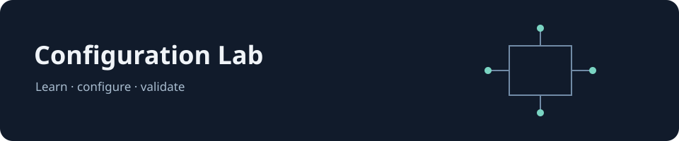

<p align="center"></p>

<p align="center">
  <a href="https://github.com/Jkaotlic/awg3-panel/actions/workflows/release-bundle.yml">Сборки</a> ·
  <a href="https://github.com/Jkaotlic/awg3-panel/releases/latest">Релизы</a> ·
  <a href="docs/install.md">Установка</a> ·
  <a href="docs/reference.md">Справочник</a>
</p>

Учебный проект для изучения сетевых конфигураций, управления подключениями
и воспроизводимого развёртывания в собственной лаборатории.

Материалы предназначены для образовательных и исследовательских целей.
Используйте их в средах, которыми вы управляете или на тестирование которых
получили разрешение. Настройки и примеры требуют проверки в конкретной среде.

### Быстрый старт

Поддерживаются чистые **Ubuntu 24.04 / Debian 13, amd64**, с systemd и TUN.
На сервере нужны `curl`, `ca-certificates`, `iproute2` и `util-linux`.

```bash
curl -fsSLo install.sh https://github.com/Jkaotlic/awg3-panel/releases/download/v0.2.0/install.sh
sudo bash install.sh --version v0.2.0
```

Мастер попросит публичный IPv4 из панели хостинга, проверит настройки и предложит
начать установку. Мастер использует стандартную подсеть и сам находит исходящий
интерфейс. В конце он покажет, как забрать профиль и войти в панель.
Комплект скачивается из GitHub Releases и проверяется по SHA256.

После установки:

1. Заберите `/root/awg3panel-admin.conf` через SCP и импортируйте на устройстве.
2. Подключитесь к созданной сети.
3. Откройте адрес панели из `/root/awg3panel-access.txt` и используйте логин/пароль
   из этого файла. Содержимое файлов храните приватно.

### Откат

Откат установки останавливает службы панели и туннеля, отключает их автозапуск
и сохраняет защищённый архив с конфигурацией и ключами. Повтор запуска исходного
комплекта поднимает сохранённую установку. Порядок возврата предыдущего бинарника
панели описан отдельно. [Установка и восстановление](docs/install.md#6-состояние-обслуживание-и-откат)

### Документация

| Материал | Содержание |
| --- | --- |
| [Установка](docs/install.md) | Требования, пошаговый запуск, первый вход, проверка и откат |
| [Справочник](docs/reference.md) | Устройство панели, конфигурация, CLI и ограничения |
| [Для ИИ-агентов](docs/AI_AGENT_INSTALL.md) | Порядок работы и проверка результата без раскрытия секретов |
| [Проверка сборки](docs/install-verification.md) | Тесты и изолированный Linux-полигон |

### Сборка и границы

GitHub Actions собирает комплект из закреплённых исходников, запускает тесты,
сканирование бинарников и проверку установки на двух поддерживаемых системах.
Публикация релиза выполняется отдельным ручным шагом после успешных проверок.

Профиль рассчитан на IPv4; DNS и IPv6/KillSwitch проверяются на клиенте.
Доступность у конкретного провайдера и пригодность для конкретной задачи
не гарантируются. Технические протоколы и зависимости перечислены в справочнике
и [уведомлениях о компонентах](deploy/THIRD_PARTY.md).
